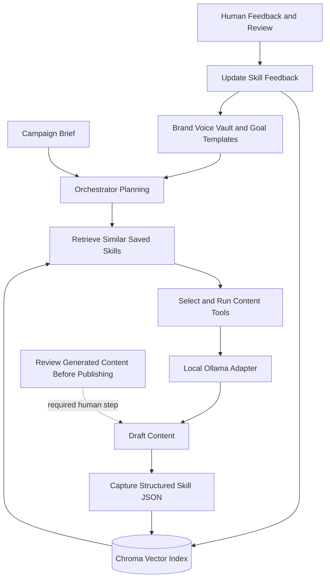

# OmniForge – Free Local AI Workbench Orchestrator

A complete, free implementation of the “Hermes-like layer above” described in the OmniForge concept.

It turns a set of content tools into a **self-improving AI workbench** that:

- Plans which tools to run and in what order
- Reuses past successful campaigns via vector similarity (skill documents)
- Captures every run as a structured skill
- Maintains a persistent Brand Voice Vault + Goal Templates
- Records human feedback so skills improve over time

**100% free & local** – uses Ollama + ChromaDB + sentence-transformers. No paid APIs required.

---

## 1. Prerequisites

### Install Ollama (one-time)

```bash
# macOS / Linux
curl -fsSL https://ollama.com/install.sh | sh

# Then pull a model (choose one)
ollama pull llama3.2
# or: ollama pull mistral
# or: ollama pull phi3
# or: ollama pull gemma2
```

Make sure the Ollama server is running (`ollama serve` or just open the app).

### Python 3.10+

---

## 2. Setup (2 minutes)

```bash
# Clone / enter the project
git clone https://github.com/dhe-cruzer69/omniforge.git
cd omniforge

# Create virtual environment
python3 -m venv venv
source venv/bin/activate          # Windows: venv\Scripts\activate

# Install dependencies
pip install -r requirements.txt
```

---

## 3. Run

### Quick demo
```bash
python main.py demo
```

### Custom campaign
```bash
python main.py run "reusable coffee cup for zero-wasters who care about design"
```

### With a specific goal template
```bash
python main.py run "summer sale for eco sneakers" --goal conversion
```

### List captured skills
```bash
python main.py skills
```

### Record feedback (self-improvement)
```bash
python main.py feedback <skill_id> "made headlines shorter and more benefit-focused" --score 9.3
```

### View / update brand voice
```bash
python main.py brand
python main.py brand --tone "warm, science-backed, optimistic" --style "short sentences, concrete numbers"
```

---

## 4. How the “layer above” works

1. **Plan** – looks at the brief + Brand Voice Vault + similar past skills (Chroma vector search).
2. **Execute** – runs the optimal tool chain (idea-gen → social-copy → tts → landing-page) using local Ollama.
3. **Capture** – writes a structured `skill_*.json` and indexes it.
4. **Learn** – next similar brief automatically reuses the winning patterns and chain.

---

<!-- X4-APEX-DIAGRAM-START:omniforge -->



<!-- X4-APEX-DIAGRAM-END:omniforge -->

## 5. Project layout

```
omniforge/
├── main.py              # CLI entry point
├── orchestrator.py      # Plan → Execute → Capture
├── skill_store.py       # Vector skill memory (Chroma)
├── memory.py            # Brand Voice + Goal Templates
├── tools.py             # Free tool adapters (Ollama)
├── config.py
├── skills/              # Saved skill JSON files
├── memory/              # Brand voice & goal templates
└── chroma_db/           # Vector index
```

---

## 6. Extending it

- Swap any tool in `tools.py` for a real API (Jasper, Murf, etc.).
- Add parallel execution with `asyncio` or a queue.
- Connect a real UI later; the orchestrator is already decoupled.
- Change the default model in `config.py` (`OLLAMA_MODEL`).

---

## Disclaimer

This is an educational / prototyping system. Generated marketing content should always be reviewed by a human before publishing.

## APEX Architecture Map

> Status: architecture documentation; implementation and deployment claims require independent verification.

**Evidence note:** Provider fallback, retrieval persistence, and offline behavior must be verified against source and tests; no model or vector-store integration is presumed live.

